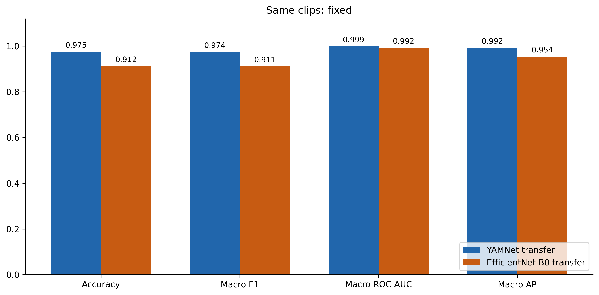
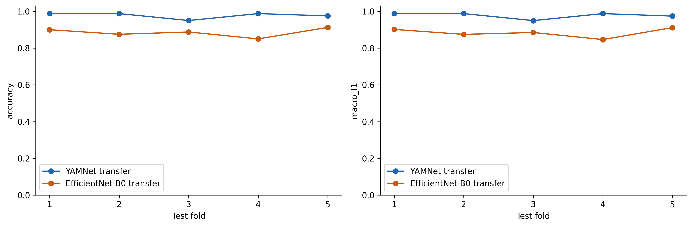
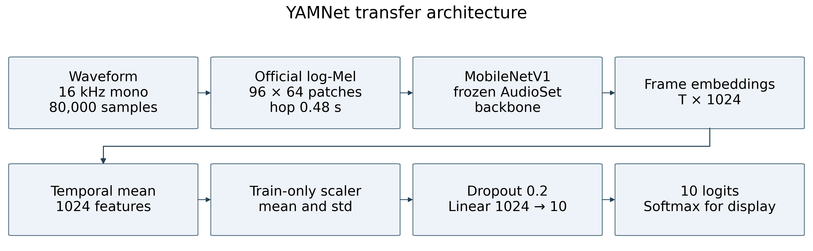
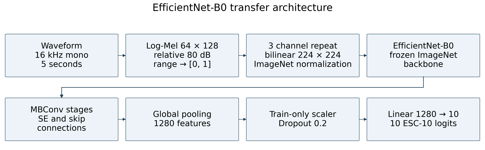
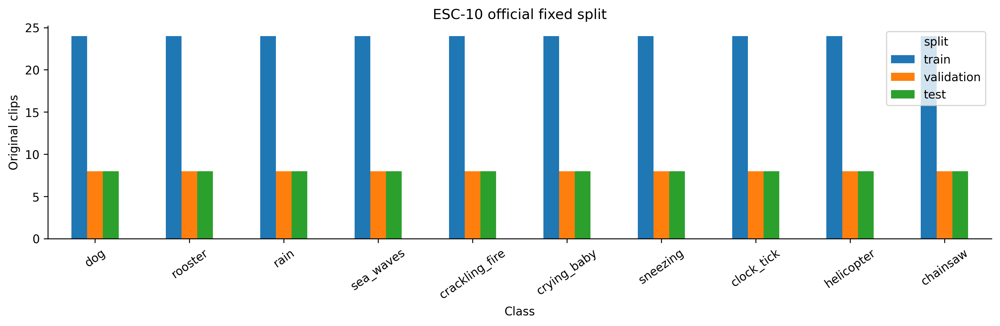

# SoundSense

Environmental sound classification with **YAMNet** and **EfficientNet-B0**, a local Gradio application, and a complete Google Colab research notebook.

[](https://colab.research.google.com/github/a1ksh/SoundSense/blob/main/colab_two_models/SoundSense_YAMNet_EfficientNet_Full_Colab.ipynb)

Upload an audio file, choose a model, and inspect its predicted category, top three scores, waveform, Mel spectrogram, and five-second audio preview. The application interface is in Kazakh; this README and the main setup guides are in English.

## Start here

| Resource | Contents |
| --- | --- |
| [Google Colab notebook](colab_two_models/SoundSense_YAMNet_EfficientNet_Full_Colab.ipynb) | Executed notebook with training outputs and all 58 figure previews |
| [Latest release](https://github.com/a1ksh/SoundSense/releases/latest) | Full trained Colab bundle, results archive, sample audio, and SHA-256 checksums |
| [Colab guide](colab_two_models/README.md) | Upload the bundle, use trained models, or train new heads |
| [Dataset guide](docs/dataset.md) | ESC-10 classes, provenance, folds, download, license, and citation |
| [Results and figure gallery](docs/results.md) | Both models, evaluation details, and all PNG/SVG/PDF exports |
| [Reproducibility guide](docs/reproducibility.md) | Local installation, verification, and retraining |

The repository is private. Access to GitHub-hosted files, release assets, and the Colab GitHub link requires repository access. If Colab cannot open the private link, download the notebook and use **File → Upload notebook**.

## Results

Both models use frozen pretrained CNN backbones and separately trained ESC-10 classification heads. These are saved experimental results, not a claim of performance on arbitrary recordings.

| Model | Evaluation | Correct | Accuracy | Macro F1 |
| --- | --- | ---: | ---: | ---: |
| YAMNet transfer | Fixed test, fold 5 | 78 / 80 | **97.50%** | **0.9739** |
| EfficientNet-B0 transfer | Fixed test, fold 5 | 73 / 80 | 91.25% | 0.9114 |
| YAMNet transfer | Five-fold out-of-fold | 391 / 400 | **97.75%** | **0.9775** |
| EfficientNet-B0 transfer | Five-fold out-of-fold | 354 / 400 | 88.50% | 0.8849 |

Source: [model comparison CSV](colab_two_models/run/tables/model_comparison.csv). Macro F1 is computed over all ten classes; the OOF value uses the combined 400 predictions rather than the mean of five fold F1 scores.





## Models

| Property | YAMNet | EfficientNet-B0 |
| --- | --- | --- |
| Pretraining | AudioSet | ImageNet |
| Frozen backbone | MobileNetV1 | EfficientNet-B0 with MBConv and squeeze-and-excitation |
| Features | Mean of 1024-dimensional audio embeddings | 1280-dimensional pooled image features |
| Frontend | Official YAMNet log-Mel frontend | Project-specific 64 × 128 power-dB Mel image; three channels; 224 × 224 resize; ImageNet normalization |
| ESC-10 head | Train-only standardization → Dropout(0.2) → Linear(1024, 10) | Train-only standardization → Dropout(0.2) → Linear(1280, 10) |
| Trainable parameters | 10,250 | 12,810 |

Only the heads are trained. The parameter counts above exclude the frozen backbones. The application defaults to YAMNet and deploys each model's fixed fold-5 checkpoint.





## Dataset

SoundSense uses **ESC-10**, the ten-class subset of [Karol J. Piczak's ESC-50 dataset](https://github.com/karolpiczak/ESC-50).

- **400 original clips:** 40 per class, five seconds per clip, mono WAV at 44.1 kHz.
- **Classes:** dog, rooster, rain, sea waves, crackling fire, crying baby, sneezing, clock tick, helicopter, and chainsaw.
- **Five official folds:** 80 clips per fold, eight clips per class in each fold.
- **Fixed split:** folds 1–3 for training (240 clips), fold 4 for validation (80), fold 5 for testing (80).
- **Five-fold evaluation:** test fold K, validation fold K−1 (fold 5 when K=1), and the remaining three folds for training.
- **Pinned upstream revision:** `33c8ce9eb2cf0b1c2f8bcf322eb349b6be34dbb6`.
- **License:** ESC-10 is CC BY 3.0. Original clip attribution and upstream license are preserved in [data/metadata](data/metadata).

Audio is converted to mono at 16 kHz; long uploads use the first five seconds and short uploads are zero-padded. Dataset WAVs are provided in the full release bundle or downloaded using the pinned manifest. See the [dataset guide](docs/dataset.md) for integrity checks and attribution.



## Run locally

Use **Python 3.11** and two environments: PyTorch/Gradio for the application and isolated TensorFlow for YAMNet. Trained application heads and the EfficientNet backbone are included in the repository. YAMNet's official backbone is downloaded on first use and cached locally.

### Windows PowerShell

```powershell
git clone https://github.com/a1ksh/SoundSense.git
cd SoundSense
py -3.11 -m venv .venv
.\.venv\Scripts\python.exe -m pip install torch==2.10.0 torchvision==0.25.0 --index-url https://download.pytorch.org/whl/cpu
.\.venv\Scripts\python.exe -m pip install -r requirements.txt
py -3.11 -m venv .venv-yamnet
.\.venv-yamnet\Scripts\python.exe -m pip install -r experiments/accuracy_v2/requirements-yamnet.txt
$env:SOUNDSENSE_YAMNET_PYTHON = (Resolve-Path '.venv-yamnet/Scripts/python.exe').Path
.\.venv\Scripts\python.exe app.py
```

For an NVIDIA GPU, replace the PyTorch `cpu` index with `cu126`. TensorFlow remains in its separate environment.

### Linux / macOS

```bash
git clone https://github.com/a1ksh/SoundSense.git
cd SoundSense
python3.11 -m venv .venv
.venv/bin/python -m pip install torch==2.10.0 torchvision==0.25.0
.venv/bin/python -m pip install -r requirements.txt
python3.11 -m venv .venv-yamnet
.venv-yamnet/bin/python -m pip install -r experiments/accuracy_v2/requirements-yamnet.txt
export SOUNDSENSE_YAMNET_PYTHON="$PWD/.venv-yamnet/bin/python"
.venv/bin/python app.py
```

The recorded execution environment is Windows with CUDA; installation on other operating systems has not been independently verified. Open the local URL printed by Gradio, normally `http://127.0.0.1:7860`. Set a port with `python app.py --port 7869`. The application runs on localhost with `share=False`.

Supported extensions: WAV/WAVE, MP3, M4A/AAC, FLAC, OGG/OGA, OPUS, AIFF/AIF, WMA, WEBM, MP4, CAF, and AU. The upload limit is 100 MB. Temporary files expire after one hour and are swept every five minutes. FFmpeg is provided through `imageio-ffmpeg`.

## Google Colab

1. Download `SoundSense_2Models_Trained_Colab.zip` from the [latest release](https://github.com/a1ksh/SoundSense/releases/latest).
2. Open or upload the [notebook](colab_two_models/SoundSense_YAMNet_EfficientNet_Full_Colab.ipynb) in Colab. Select a GPU runtime with a Python version supported by the notebook; its setup targets Python 3.10–3.12.
3. Set `RUN_MODE = 'use_trained'` to verify the supplied checkpoints and regenerate results, or `'retrain'` to train new heads. The notebook defaults to `'retrain'`.
4. Run all cells and upload the full bundle when prompted. Download the exported results ZIP at the end.

The full bundle contains all 400 WAVs, both frozen backbones, feature caches, ten trained heads, epoch histories, predictions, and figures. `USE_BUNDLE=False` downloads the original dataset and backbones and recomputes features. See the [Colab guide](colab_two_models/README.md).

**Execution provenance:** saved notebook outputs were produced by a real local GPU run. The notebook has not been independently executed on Google's hosted Colab runtime. Its saved environment and checks explicitly record this distinction.

## Verification and API

With the main environment activated:

```bash
python -m soundsense.download_data
python -m pytest -q
python -m experiments.accuracy_v2.check
```

The comprehensive YAMNet check also needs its saved feature cache; the [reproducibility guide](docs/reproducibility.md) explains the required assets. To verify both deployed models against their saved predictions, start the app and run:

```bash
python -m tools.check_website_models --url http://127.0.0.1:7860
```

The Gradio `/predict` endpoint accepts an audio file and a model name (`YAMNet` or `EfficientNet-B0`). It returns five outputs: category, top-three scores, waveform plot, Mel plot, and audio preview. Omitting the model uses YAMNet.

```python
from gradio_client import Client, handle_file

client = Client("http://127.0.0.1:7860")
category, top3, waveform, mel, preview = client.predict(
    handle_file("example.wav"), "EfficientNet-B0", api_name="/predict"
)
```

## Repository layout

```text
app.py                     Local Gradio entry point
soundsense/                Audio processing, predictors, and interface
assets/                    Interface styles and JavaScript
models/                    Deployed heads, EfficientNet backbone, and notices
experiments/accuracy_v2/    YAMNet training, provenance, and verification
colab_two_models/          Full notebook, workflow, both models' research results
data/metadata/             Pinned ESC-10 manifest, hashes, and clip attribution
reports/                   Saved evaluation and application verification
results/                   YAMNet report exports
docs/                      Dataset, setup, results, and supplementary Kazakh reports
tests/                     Model, preprocessing, worker, and application checks
tools/                     Local verification utilities
```

Virtual environments, caches, temporary requests, duplicate coursework documents, and generated ZIP bundles are excluded from Git. Downloadable bundles are distributed as release assets. Older MLP/CNN checkpoints and obsolete experiment outputs have been removed from the current source tree; their commits remain in Git history.

## Evaluation limits

ESC-10 is small, and the experiment uses one seed (42). The fixed test had been inspected in earlier work, and model selection historically used fixed validation results; this is not fully nested model selection. Fold training sets overlap, and fold standard deviation is not a confidence interval. Different pretraining domains and frontends mean the comparison does not isolate architecture alone. No external test set, unknown-class rejection, multi-label evaluation, or fitted confidence calibration is provided. Possible overlap between AudioSet pretraining and ESC recordings has not been audited. An unknown sound will still receive one of the ten labels.

## References and attribution

- Karol J. Piczak (2015). *ESC: Dataset for Environmental Sound Classification*. ACM Multimedia, pp. 1015–1018. [DOI: 10.1145/2733373.2806390](https://doi.org/10.1145/2733373.2806390).
- [ESC-50 / ESC-10 upstream repository](https://github.com/karolpiczak/ESC-50) and [preserved clip attribution](data/metadata/attributions.csv).
- [Official TensorFlow YAMNet transfer learning tutorial](https://www.tensorflow.org/tutorials/audio/transfer_learning_audio).
- [MobileNets paper](https://arxiv.org/abs/1704.04861) and [EfficientNet paper](https://arxiv.org/abs/1905.11946).
- [Torchvision EfficientNet-B0 documentation](https://docs.pytorch.org/vision/0.25/models/generated/torchvision.models.efficientnet_b0.html).
- [Third-party model licenses and notices](colab_two_models/assets/licenses). Dataset and third-party model licenses apply to their respective assets.
