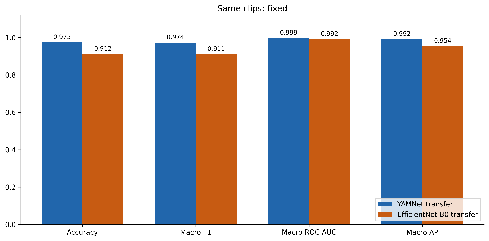
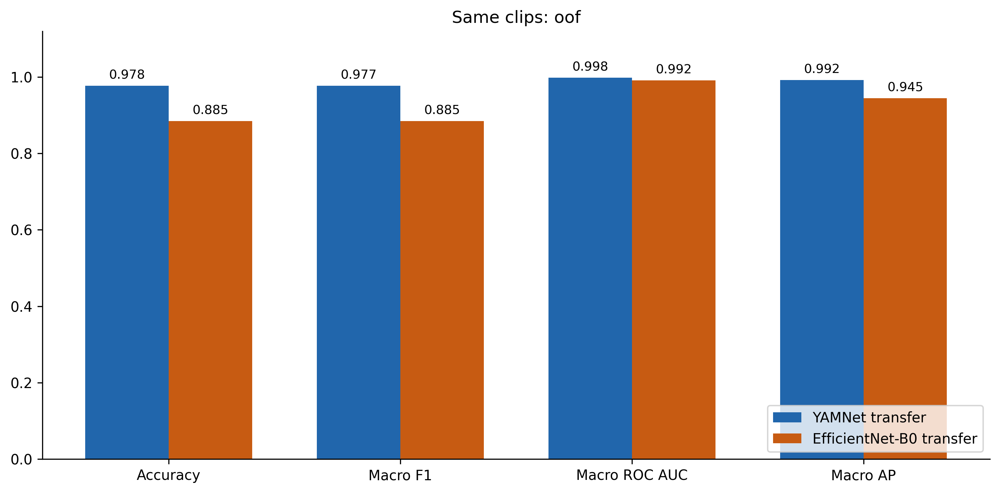

# Results and figure gallery

The two-model experiment exports **58 figures** in three formats: **300 dpi PNG**, **SVG**, and **PDF**. Every notebook preview identifies its original PNG by SHA-256. The plots are derived from saved predictions, actual epoch histories, original waveforms, and model architecture tables.

## Main results

| Model | Evaluation | Correct | Accuracy | Macro F1 | Macro ROC AUC | Macro AP |
| --- | --- | ---: | ---: | ---: | ---: | ---: |
| YAMNet transfer | Fixed test fold 5 | 78 / 80 | 97.50% | 0.9739 | 0.9988 | 0.9924 |
| EfficientNet-B0 transfer | Fixed test fold 5 | 73 / 80 | 91.25% | 0.9114 | 0.9922 | 0.9544 |
| YAMNet transfer | Five-fold OOF | 391 / 400 | 97.75% | 0.9775 | 0.9984 | 0.9921 |
| EfficientNet-B0 transfer | Five-fold OOF | 354 / 400 | 88.50% | 0.8849 | 0.9915 | 0.9445 |

Numerical source: [model_comparison.csv](../colab_two_models/run/tables/model_comparison.csv). OOF macro F1 is calculated over all 400 pooled predictions. Macro AP uses average precision rather than trapezoidal integration of the PR curve.

The fixed split is train folds 1–3, validation fold 4, test fold 5. Five-fold OOF evaluation uses one test fold, the preceding fold for validation, and three folds for training. Seed: 42. Scalers use training data only. Minimum validation loss selects the checkpoint. Both backbones remain frozen.

## Evidence files

| Evidence | Location |
| --- | --- |
| Per-clip scores and misclassifications | [run/predictions](../colab_two_models/run/predictions) |
| Per-class metrics, confusion matrices, ROC/PR data | [run/metrics](../colab_two_models/run/metrics) |
| Actual epoch histories and training metadata | [run/history](../colab_two_models/run/history) |
| Ten trained heads | [run/models](../colab_two_models/run/models) |
| Architecture stage tables | [run/architecture](../colab_two_models/run/architecture) |
| Fold roles and comparison tables | [run/tables](../colab_two_models/run/tables) |
| Full figure inventory with PNG hashes | [figure_inventory.json](../colab_two_models/run/figure_inventory.json) |
| Original execution checks | [checks.json](../colab_two_models/run/checks.json) |
| Original execution environment | [environment.json](../colab_two_models/run/environment.json) |
| Supplementary Kazakh report | [report_kk.md](../colab_two_models/run/report_kk.md) |

## All 58 figures

The inventory contains 16 result plots per model, four dataset/frontend figures, five architecture/protocol diagrams, twelve direct comparison plots, and five confidence, reliability, resource, and error-example plots.

| # | Figure | PNG | SVG | PDF |
| ---: | --- | --- | --- | --- |
| 1 | Architecture YAMNet | [PNG](../colab_two_models/run/figures/png/architecture_yamnet.png) | [SVG](../colab_two_models/run/figures/svg/architecture_yamnet.svg) | [PDF](../colab_two_models/run/figures/pdf/architecture_yamnet.pdf) |
| 2 | Architecture EfficientNet-B0 | [PNG](../colab_two_models/run/figures/png/architecture_efficientnet.png) | [SVG](../colab_two_models/run/figures/svg/architecture_efficientnet.svg) | [PDF](../colab_two_models/run/figures/pdf/architecture_efficientnet.pdf) |
| 3 | Architecture YAMNet block | [PNG](../colab_two_models/run/figures/png/architecture_yamnet_block.png) | [SVG](../colab_two_models/run/figures/svg/architecture_yamnet_block.svg) | [PDF](../colab_two_models/run/figures/pdf/architecture_yamnet_block.pdf) |
| 4 | Architecture MBConv | [PNG](../colab_two_models/run/figures/png/architecture_mbconv.png) | [SVG](../colab_two_models/run/figures/svg/architecture_mbconv.svg) | [PDF](../colab_two_models/run/figures/pdf/architecture_mbconv.pdf) |
| 5 | Architecture protocol | [PNG](../colab_two_models/run/figures/png/architecture_protocol.png) | [SVG](../colab_two_models/run/figures/svg/architecture_protocol.svg) | [PDF](../colab_two_models/run/figures/pdf/architecture_protocol.pdf) |
| 6 | Data class distribution | [PNG](../colab_two_models/run/figures/png/data_class_distribution.png) | [SVG](../colab_two_models/run/figures/svg/data_class_distribution.svg) | [PDF](../colab_two_models/run/figures/pdf/data_class_distribution.pdf) |
| 7 | Data waveforms | [PNG](../colab_two_models/run/figures/png/data_waveforms.png) | [SVG](../colab_two_models/run/figures/svg/data_waveforms.svg) | [PDF](../colab_two_models/run/figures/pdf/data_waveforms.pdf) |
| 8 | YAMNet transfer frontend examples | [PNG](../colab_two_models/run/figures/png/yamnet_transfer_frontend_examples.png) | [SVG](../colab_two_models/run/figures/svg/yamnet_transfer_frontend_examples.svg) | [PDF](../colab_two_models/run/figures/pdf/yamnet_transfer_frontend_examples.pdf) |
| 9 | EfficientNet-B0 b0 mel frontend examples | [PNG](../colab_two_models/run/figures/png/efficientnet_b0_mel_frontend_examples.png) | [SVG](../colab_two_models/run/figures/svg/efficientnet_b0_mel_frontend_examples.svg) | [PDF](../colab_two_models/run/figures/pdf/efficientnet_b0_mel_frontend_examples.pdf) |
| 10 | YAMNet transfer fold1 training | [PNG](../colab_two_models/run/figures/png/yamnet_transfer_fold1_training.png) | [SVG](../colab_two_models/run/figures/svg/yamnet_transfer_fold1_training.svg) | [PDF](../colab_two_models/run/figures/pdf/yamnet_transfer_fold1_training.pdf) |
| 11 | YAMNet transfer fold2 training | [PNG](../colab_two_models/run/figures/png/yamnet_transfer_fold2_training.png) | [SVG](../colab_two_models/run/figures/svg/yamnet_transfer_fold2_training.svg) | [PDF](../colab_two_models/run/figures/pdf/yamnet_transfer_fold2_training.pdf) |
| 12 | YAMNet transfer fold3 training | [PNG](../colab_two_models/run/figures/png/yamnet_transfer_fold3_training.png) | [SVG](../colab_two_models/run/figures/svg/yamnet_transfer_fold3_training.svg) | [PDF](../colab_two_models/run/figures/pdf/yamnet_transfer_fold3_training.pdf) |
| 13 | YAMNet transfer fold4 training | [PNG](../colab_two_models/run/figures/png/yamnet_transfer_fold4_training.png) | [SVG](../colab_two_models/run/figures/svg/yamnet_transfer_fold4_training.svg) | [PDF](../colab_two_models/run/figures/pdf/yamnet_transfer_fold4_training.pdf) |
| 14 | YAMNet transfer fixed training | [PNG](../colab_two_models/run/figures/png/yamnet_transfer_fixed_training.png) | [SVG](../colab_two_models/run/figures/svg/yamnet_transfer_fixed_training.svg) | [PDF](../colab_two_models/run/figures/pdf/yamnet_transfer_fixed_training.pdf) |
| 15 | YAMNet transfer fixed confusion | [PNG](../colab_two_models/run/figures/png/yamnet_transfer_fixed_confusion.png) | [SVG](../colab_two_models/run/figures/svg/yamnet_transfer_fixed_confusion.svg) | [PDF](../colab_two_models/run/figures/pdf/yamnet_transfer_fixed_confusion.pdf) |
| 16 | YAMNet transfer fixed confusion normalized | [PNG](../colab_two_models/run/figures/png/yamnet_transfer_fixed_confusion_normalized.png) | [SVG](../colab_two_models/run/figures/svg/yamnet_transfer_fixed_confusion_normalized.svg) | [PDF](../colab_two_models/run/figures/pdf/yamnet_transfer_fixed_confusion_normalized.pdf) |
| 17 | YAMNet transfer fixed per class F1 | [PNG](../colab_two_models/run/figures/png/yamnet_transfer_fixed_per_class_f1.png) | [SVG](../colab_two_models/run/figures/svg/yamnet_transfer_fixed_per_class_f1.svg) | [PDF](../colab_two_models/run/figures/pdf/yamnet_transfer_fixed_per_class_f1.pdf) |
| 18 | YAMNet transfer fixed ROC | [PNG](../colab_two_models/run/figures/png/yamnet_transfer_fixed_roc.png) | [SVG](../colab_two_models/run/figures/svg/yamnet_transfer_fixed_roc.svg) | [PDF](../colab_two_models/run/figures/pdf/yamnet_transfer_fixed_roc.pdf) |
| 19 | YAMNet transfer fixed precision recall | [PNG](../colab_two_models/run/figures/png/yamnet_transfer_fixed_precision_recall.png) | [SVG](../colab_two_models/run/figures/svg/yamnet_transfer_fixed_precision_recall.svg) | [PDF](../colab_two_models/run/figures/pdf/yamnet_transfer_fixed_precision_recall.pdf) |
| 20 | YAMNet transfer OOF confusion | [PNG](../colab_two_models/run/figures/png/yamnet_transfer_oof_confusion.png) | [SVG](../colab_two_models/run/figures/svg/yamnet_transfer_oof_confusion.svg) | [PDF](../colab_two_models/run/figures/pdf/yamnet_transfer_oof_confusion.pdf) |
| 21 | YAMNet transfer OOF confusion normalized | [PNG](../colab_two_models/run/figures/png/yamnet_transfer_oof_confusion_normalized.png) | [SVG](../colab_two_models/run/figures/svg/yamnet_transfer_oof_confusion_normalized.svg) | [PDF](../colab_two_models/run/figures/pdf/yamnet_transfer_oof_confusion_normalized.pdf) |
| 22 | YAMNet transfer OOF per class F1 | [PNG](../colab_two_models/run/figures/png/yamnet_transfer_oof_per_class_f1.png) | [SVG](../colab_two_models/run/figures/svg/yamnet_transfer_oof_per_class_f1.svg) | [PDF](../colab_two_models/run/figures/pdf/yamnet_transfer_oof_per_class_f1.pdf) |
| 23 | YAMNet transfer OOF ROC | [PNG](../colab_two_models/run/figures/png/yamnet_transfer_oof_roc.png) | [SVG](../colab_two_models/run/figures/svg/yamnet_transfer_oof_roc.svg) | [PDF](../colab_two_models/run/figures/pdf/yamnet_transfer_oof_roc.pdf) |
| 24 | YAMNet transfer OOF precision recall | [PNG](../colab_two_models/run/figures/png/yamnet_transfer_oof_precision_recall.png) | [SVG](../colab_two_models/run/figures/svg/yamnet_transfer_oof_precision_recall.svg) | [PDF](../colab_two_models/run/figures/pdf/yamnet_transfer_oof_precision_recall.pdf) |
| 25 | YAMNet transfer OOF fold metrics | [PNG](../colab_two_models/run/figures/png/yamnet_transfer_oof_fold_metrics.png) | [SVG](../colab_two_models/run/figures/svg/yamnet_transfer_oof_fold_metrics.svg) | [PDF](../colab_two_models/run/figures/pdf/yamnet_transfer_oof_fold_metrics.pdf) |
| 26 | EfficientNet-B0 b0 mel fold1 training | [PNG](../colab_two_models/run/figures/png/efficientnet_b0_mel_fold1_training.png) | [SVG](../colab_two_models/run/figures/svg/efficientnet_b0_mel_fold1_training.svg) | [PDF](../colab_two_models/run/figures/pdf/efficientnet_b0_mel_fold1_training.pdf) |
| 27 | EfficientNet-B0 b0 mel fold2 training | [PNG](../colab_two_models/run/figures/png/efficientnet_b0_mel_fold2_training.png) | [SVG](../colab_two_models/run/figures/svg/efficientnet_b0_mel_fold2_training.svg) | [PDF](../colab_two_models/run/figures/pdf/efficientnet_b0_mel_fold2_training.pdf) |
| 28 | EfficientNet-B0 b0 mel fold3 training | [PNG](../colab_two_models/run/figures/png/efficientnet_b0_mel_fold3_training.png) | [SVG](../colab_two_models/run/figures/svg/efficientnet_b0_mel_fold3_training.svg) | [PDF](../colab_two_models/run/figures/pdf/efficientnet_b0_mel_fold3_training.pdf) |
| 29 | EfficientNet-B0 b0 mel fold4 training | [PNG](../colab_two_models/run/figures/png/efficientnet_b0_mel_fold4_training.png) | [SVG](../colab_two_models/run/figures/svg/efficientnet_b0_mel_fold4_training.svg) | [PDF](../colab_two_models/run/figures/pdf/efficientnet_b0_mel_fold4_training.pdf) |
| 30 | EfficientNet-B0 b0 mel fixed training | [PNG](../colab_two_models/run/figures/png/efficientnet_b0_mel_fixed_training.png) | [SVG](../colab_two_models/run/figures/svg/efficientnet_b0_mel_fixed_training.svg) | [PDF](../colab_two_models/run/figures/pdf/efficientnet_b0_mel_fixed_training.pdf) |
| 31 | EfficientNet-B0 b0 mel fixed confusion | [PNG](../colab_two_models/run/figures/png/efficientnet_b0_mel_fixed_confusion.png) | [SVG](../colab_two_models/run/figures/svg/efficientnet_b0_mel_fixed_confusion.svg) | [PDF](../colab_two_models/run/figures/pdf/efficientnet_b0_mel_fixed_confusion.pdf) |
| 32 | EfficientNet-B0 b0 mel fixed confusion normalized | [PNG](../colab_two_models/run/figures/png/efficientnet_b0_mel_fixed_confusion_normalized.png) | [SVG](../colab_two_models/run/figures/svg/efficientnet_b0_mel_fixed_confusion_normalized.svg) | [PDF](../colab_two_models/run/figures/pdf/efficientnet_b0_mel_fixed_confusion_normalized.pdf) |
| 33 | EfficientNet-B0 b0 mel fixed per class F1 | [PNG](../colab_two_models/run/figures/png/efficientnet_b0_mel_fixed_per_class_f1.png) | [SVG](../colab_two_models/run/figures/svg/efficientnet_b0_mel_fixed_per_class_f1.svg) | [PDF](../colab_two_models/run/figures/pdf/efficientnet_b0_mel_fixed_per_class_f1.pdf) |
| 34 | EfficientNet-B0 b0 mel fixed ROC | [PNG](../colab_two_models/run/figures/png/efficientnet_b0_mel_fixed_roc.png) | [SVG](../colab_two_models/run/figures/svg/efficientnet_b0_mel_fixed_roc.svg) | [PDF](../colab_two_models/run/figures/pdf/efficientnet_b0_mel_fixed_roc.pdf) |
| 35 | EfficientNet-B0 b0 mel fixed precision recall | [PNG](../colab_two_models/run/figures/png/efficientnet_b0_mel_fixed_precision_recall.png) | [SVG](../colab_two_models/run/figures/svg/efficientnet_b0_mel_fixed_precision_recall.svg) | [PDF](../colab_two_models/run/figures/pdf/efficientnet_b0_mel_fixed_precision_recall.pdf) |
| 36 | EfficientNet-B0 b0 mel OOF confusion | [PNG](../colab_two_models/run/figures/png/efficientnet_b0_mel_oof_confusion.png) | [SVG](../colab_two_models/run/figures/svg/efficientnet_b0_mel_oof_confusion.svg) | [PDF](../colab_two_models/run/figures/pdf/efficientnet_b0_mel_oof_confusion.pdf) |
| 37 | EfficientNet-B0 b0 mel OOF confusion normalized | [PNG](../colab_two_models/run/figures/png/efficientnet_b0_mel_oof_confusion_normalized.png) | [SVG](../colab_two_models/run/figures/svg/efficientnet_b0_mel_oof_confusion_normalized.svg) | [PDF](../colab_two_models/run/figures/pdf/efficientnet_b0_mel_oof_confusion_normalized.pdf) |
| 38 | EfficientNet-B0 b0 mel OOF per class F1 | [PNG](../colab_two_models/run/figures/png/efficientnet_b0_mel_oof_per_class_f1.png) | [SVG](../colab_two_models/run/figures/svg/efficientnet_b0_mel_oof_per_class_f1.svg) | [PDF](../colab_two_models/run/figures/pdf/efficientnet_b0_mel_oof_per_class_f1.pdf) |
| 39 | EfficientNet-B0 b0 mel OOF ROC | [PNG](../colab_two_models/run/figures/png/efficientnet_b0_mel_oof_roc.png) | [SVG](../colab_two_models/run/figures/svg/efficientnet_b0_mel_oof_roc.svg) | [PDF](../colab_two_models/run/figures/pdf/efficientnet_b0_mel_oof_roc.pdf) |
| 40 | EfficientNet-B0 b0 mel OOF precision recall | [PNG](../colab_two_models/run/figures/png/efficientnet_b0_mel_oof_precision_recall.png) | [SVG](../colab_two_models/run/figures/svg/efficientnet_b0_mel_oof_precision_recall.svg) | [PDF](../colab_two_models/run/figures/pdf/efficientnet_b0_mel_oof_precision_recall.pdf) |
| 41 | EfficientNet-B0 b0 mel OOF fold metrics | [PNG](../colab_two_models/run/figures/png/efficientnet_b0_mel_oof_fold_metrics.png) | [SVG](../colab_two_models/run/figures/svg/efficientnet_b0_mel_oof_fold_metrics.svg) | [PDF](../colab_two_models/run/figures/pdf/efficientnet_b0_mel_oof_fold_metrics.pdf) |
| 42 | Comparison fixed metrics | [PNG](../colab_two_models/run/figures/png/comparison_fixed_metrics.png) | [SVG](../colab_two_models/run/figures/svg/comparison_fixed_metrics.svg) | [PDF](../colab_two_models/run/figures/pdf/comparison_fixed_metrics.pdf) |
| 43 | Comparison fixed per class F1 | [PNG](../colab_two_models/run/figures/png/comparison_fixed_per_class_f1.png) | [SVG](../colab_two_models/run/figures/svg/comparison_fixed_per_class_f1.svg) | [PDF](../colab_two_models/run/figures/pdf/comparison_fixed_per_class_f1.pdf) |
| 44 | Comparison fixed ROC | [PNG](../colab_two_models/run/figures/png/comparison_fixed_roc.png) | [SVG](../colab_two_models/run/figures/svg/comparison_fixed_roc.svg) | [PDF](../colab_two_models/run/figures/pdf/comparison_fixed_roc.pdf) |
| 45 | Comparison fixed precision recall | [PNG](../colab_two_models/run/figures/png/comparison_fixed_precision_recall.png) | [SVG](../colab_two_models/run/figures/svg/comparison_fixed_precision_recall.svg) | [PDF](../colab_two_models/run/figures/pdf/comparison_fixed_precision_recall.pdf) |
| 46 | Comparison OOF metrics | [PNG](../colab_two_models/run/figures/png/comparison_oof_metrics.png) | [SVG](../colab_two_models/run/figures/svg/comparison_oof_metrics.svg) | [PDF](../colab_two_models/run/figures/pdf/comparison_oof_metrics.pdf) |
| 47 | Comparison OOF per class F1 | [PNG](../colab_two_models/run/figures/png/comparison_oof_per_class_f1.png) | [SVG](../colab_two_models/run/figures/svg/comparison_oof_per_class_f1.svg) | [PDF](../colab_two_models/run/figures/pdf/comparison_oof_per_class_f1.pdf) |
| 48 | Comparison OOF ROC | [PNG](../colab_two_models/run/figures/png/comparison_oof_roc.png) | [SVG](../colab_two_models/run/figures/svg/comparison_oof_roc.svg) | [PDF](../colab_two_models/run/figures/pdf/comparison_oof_roc.pdf) |
| 49 | Comparison OOF precision recall | [PNG](../colab_two_models/run/figures/png/comparison_oof_precision_recall.png) | [SVG](../colab_two_models/run/figures/svg/comparison_oof_precision_recall.svg) | [PDF](../colab_two_models/run/figures/pdf/comparison_oof_precision_recall.pdf) |
| 50 | Comparison folds | [PNG](../colab_two_models/run/figures/png/comparison_folds.png) | [SVG](../colab_two_models/run/figures/svg/comparison_folds.svg) | [PDF](../colab_two_models/run/figures/pdf/comparison_folds.pdf) |
| 51 | Comparison fold difference | [PNG](../colab_two_models/run/figures/png/comparison_fold_difference.png) | [SVG](../colab_two_models/run/figures/svg/comparison_fold_difference.svg) | [PDF](../colab_two_models/run/figures/pdf/comparison_fold_difference.pdf) |
| 52 | Comparison fixed training | [PNG](../colab_two_models/run/figures/png/comparison_fixed_training.png) | [SVG](../colab_two_models/run/figures/svg/comparison_fixed_training.svg) | [PDF](../colab_two_models/run/figures/pdf/comparison_fixed_training.pdf) |
| 53 | Comparison OOF agreement | [PNG](../colab_two_models/run/figures/png/comparison_oof_agreement.png) | [SVG](../colab_two_models/run/figures/svg/comparison_oof_agreement.svg) | [PDF](../colab_two_models/run/figures/pdf/comparison_oof_agreement.pdf) |
| 54 | Comparison fixed confidence | [PNG](../colab_two_models/run/figures/png/comparison_fixed_confidence.png) | [SVG](../colab_two_models/run/figures/svg/comparison_fixed_confidence.svg) | [PDF](../colab_two_models/run/figures/pdf/comparison_fixed_confidence.pdf) |
| 55 | Comparison fixed reliability | [PNG](../colab_two_models/run/figures/png/comparison_fixed_reliability.png) | [SVG](../colab_two_models/run/figures/svg/comparison_fixed_reliability.svg) | [PDF](../colab_two_models/run/figures/pdf/comparison_fixed_reliability.pdf) |
| 56 | Comparison head resources | [PNG](../colab_two_models/run/figures/png/comparison_head_resources.png) | [SVG](../colab_two_models/run/figures/svg/comparison_head_resources.svg) | [PDF](../colab_two_models/run/figures/pdf/comparison_head_resources.pdf) |
| 57 | YAMNet transfer fixed error examples | [PNG](../colab_two_models/run/figures/png/yamnet_transfer_fixed_error_examples.png) | [SVG](../colab_two_models/run/figures/svg/yamnet_transfer_fixed_error_examples.svg) | [PDF](../colab_two_models/run/figures/pdf/yamnet_transfer_fixed_error_examples.pdf) |
| 58 | EfficientNet-B0 b0 mel fixed error examples | [PNG](../colab_two_models/run/figures/png/efficientnet_b0_mel_fixed_error_examples.png) | [SVG](../colab_two_models/run/figures/svg/efficientnet_b0_mel_fixed_error_examples.svg) | [PDF](../colab_two_models/run/figures/pdf/efficientnet_b0_mel_fixed_error_examples.pdf) |

## Interpretation

Confusion-matrix rows are true labels and columns are predictions. A row-normalized diagonal is recall. ROC and PR use one-vs-rest scores. Confidence and reliability plots describe existing scores; no calibration model was fitted. Error waveform figures show the first six errors where available; complete misclassification tables are saved separately.

These are results on a small, previously inspected dataset with one seed. The historical model selection was not fully nested, the training partitions overlap, pretraining domains and frontends differ, and there is no external test set. Fold standard deviation is not a confidence interval. See [evaluation limits](../README.md#evaluation-limits).
